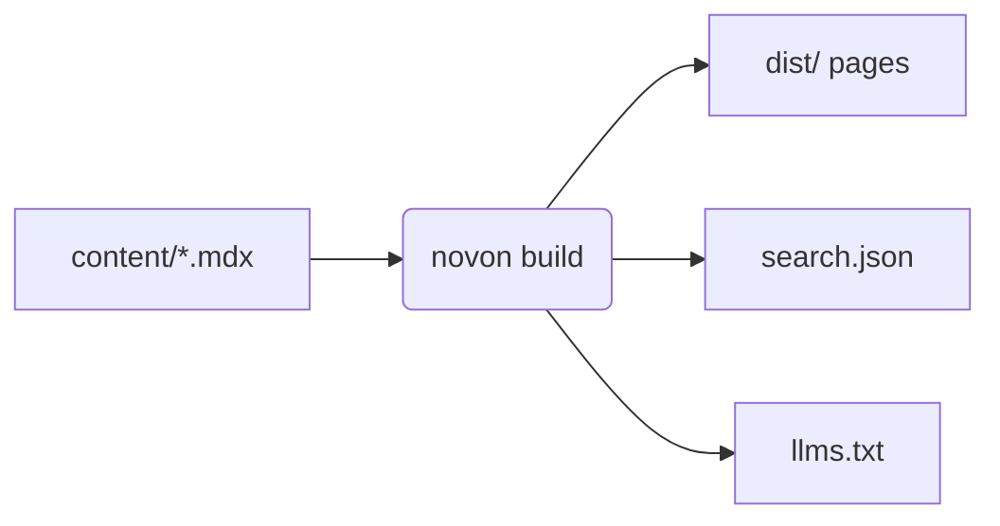
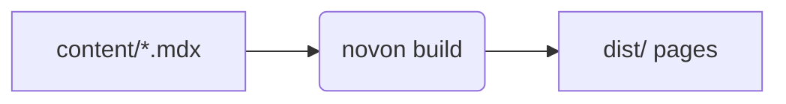

## Callouts

<Note>Context the reader may want.</Note>
<Tip title="Faster">A better way to do the same thing.</Tip>
<Warning>Something that can go wrong.</Warning>
<Danger>Something that loses data.</Danger>

```mdx
<Note>Context the reader may want.</Note>
<Tip title="Faster">A better way to do the same thing.</Tip>
```

`Info` and `Caution` exist too. `<Callout type="tip">` is the long form.

Plain Markdown works as well: a `:::` block with an optional title, or a
GitHub-style alert.

:::tip[No import needed]
Directives and alerts become the same callouts.
:::

> [!WARNING]
> Alerts take `NOTE`, `TIP`, `IMPORTANT`, `WARNING` and `CAUTION`.

```md
:::tip[No import needed]
Directives and alerts become the same callouts.
:::

> [!WARNING]
> Alerts take `NOTE`, `TIP`, `IMPORTANT`, `WARNING` and `CAUTION`.
```

Directives take `note`, `tip`, `info`, `warning`, `caution` and `danger`.
`IMPORTANT` maps to `info`, `CAUTION` to `danger`.

## Cards

```mdx
<CardGroup cols={2}>
  <Card title="Guide" icon="Bookmark" href="/guide">Read this first.</Card>
  <Card title="GitHub" icon="Github" href="https://github.com">Source.</Card>
</CardGroup>
```

## Steps

<Steps>
  <Step title="Write">Add a file.</Step>
  <Step title="Preview">Run `novon dev`.</Step>
</Steps>

## Tabs

<Tabs>
  <Tab title="bun">`bun add -g novon`</Tab>
  <Tab title="npm">`npm i -g novon`</Tab>
</Tabs>

## Code

Fences are highlighted at build time, in both themes. `title` adds a caption.

```ts title="novon.config.ts"
import { defineConfig } from 'novon/config'

export default defineConfig({ title: 'My site' })
```

The fence line marks lines and words; comments in the code mark single lines
and are removed from the output.

```ts title="greet.ts" {2} /name/ lineNumbers
export function greet(name: string) {
  const text = `Hello, ${name}`
  console.log(text) // [!code --]
  return text // [!code ++]
}
```

````text
```ts title="greet.ts" {2} /name/ lineNumbers
export function greet(name: string) {
  const text = `Hello, ${name}`
  console.log(text) // [!code --]
  return text // [!code ++]
}
```
````

On the fence line:

| Write | Effect |
| --- | --- |
| `title="file.ts"` | caption and file icon |
| `{1,3-5}` | highlight lines |
| `/word/` | highlight a word |
| `lineNumbers` | number the lines |
| `wrap` | wrap long lines |

At the end of a line, in a comment:

| Write | Effect |
| --- | --- |
| `[!code highlight]` | highlight the line |
| `[!code ++]`, `[!code --]` | added or removed line |
| `[!code focus]` | dim the other lines |
| `[!code word:name]` | highlight a word |

`mdx.lineNumbers: true` numbers every block; `lineNumbers=false` opts one out.
Any comment style works: `//`, `#`, `<!-- -->`.

Several fences in a `CodeGroup` become tabs:

<CodeGroup>

```bash title="bun"
bun add -g novon
```

```bash title="npm"
npm i -g novon
```

</CodeGroup>

## Install commands

`PackageInstall` writes one command per package manager. The reader's pick is
remembered across pages.

<PackageInstall packages="novon" dev />

```mdx
<PackageInstall packages="novon" dev />
<PackageInstall packages="novon" global />
<PackageInstall run="build" />
<PackageInstall exec="novon new site" />
<PackageInstall create="vite my-app" managers="pnpm bun" />
```

`managers` picks and orders the tabs; the default is npm, pnpm, yarn and bun.

## Math

`$…$` is inline math and `$$…$$` a block, rendered at build time, so pages
load no math code.

The area of a circle is $A = \pi r^2$, and

$$
\int_0^1 x^2\,dx = \frac{1}{3}
$$

```mdx
The area of a circle is $A = \pi r^2$, and

$$
\int_0^1 x^2\,dx = \frac{1}{3}
$$
```

`mdx.math: { singleDollar: false }` keeps single dollars as text (prices);
`mdx.math: false` turns math off.

## Diagrams

A `mermaid` fence becomes a diagram in the page's colours, light or dark. It is
drawn in the browser, and the drawing code loads only on pages that have one.
Click a diagram to see it full size.



````mdx

````

`mdx.mermaid: false` leaves `mermaid` fences as code.

## Type tables

`TypeTable` lists props, options or fields: name, type, default and
description. Write the rows as `Field` elements, or pass an object as `type`.

<TypeTable>
  <Field name="title" type="string" required>Page title and `<title>`.</Field>
  <Field name="order" type="number" default="Infinity">Lower comes first in the sidebar.</Field>
  <Field name="badge" type="string">A short tag beside the sidebar link.</Field>
</TypeTable>

```mdx
<TypeTable>
  <Field name="title" type="string" required>Page title and `<title>`.</Field>
  <Field name="order" type="number" default="Infinity">Lower comes first.</Field>
</TypeTable>

<TypeTable type={{ badge: { type: 'string', description: 'A short tag.' } }} />
```

## Diffs

`Diff` shows a change to a file. Put a `diff` fence inside, or pass `before`
and `after`. Lines start with `+`, `-` or a space; `split` shows the two sides
next to each other.

<Diff file="novon.config.ts">
```diff
 export default defineConfig({
   title: 'Acme',
-  layout: 'blog',
+  layout: 'docs',
+  banner: 'Version 2 is out',
 })
```
</Diff>

````mdx
<Diff file="novon.config.ts">
```diff
 export default defineConfig({
-  layout: 'blog',
+  layout: 'docs',
 })
```
</Diff>
````

## Prompts

`Prompt` is text for an AI assistant with a copy button. The copy is the
source as written; one short line shows as a command bar.

<Prompt title="Add a page">
Read https://qinyangwang.github.io/novon/llms.txt, then add a page called
"Deploying" to my novon site that explains GitHub Pages.
</Prompt>

```mdx
<Prompt title="Add a page">
Read https://example.com/llms.txt, then add a page called "Deploying".
</Prompt>
```

## Images

Markdown images open full size on click; `theme.imageZoom: false` turns that
off. `ImageZoom` takes a larger file for the zoomed view:


```mdx

<ImageZoom src="/shots/small.png" zoomSrc="/shots/large.png" alt="Dashboard" />
```

## Partials and variables

A file in `content/_partials/` is a partial: `<Partial file="name" />` puts its
content in place, before the page is compiled, indexed or checked. The tag's
other attributes fill the partial's `{{name}}` placeholders.

```mdx title="content/_partials/new-site.mdx"
novon new {{name}}
```

```mdx
<Partial file="new-site" name="my-docs" />
```

`{{name}}` anywhere in a page, code included, is replaced with
`variables.name` from the config: install commands here read
`novon@\{{version}}`. Write `\\{{name}}` to keep the braces. An unknown variable
or a missing partial is an error in `novon check`.

## Accordion

<AccordionGroup>
  <Accordion title="Does a site need a package.json?">No. Imports resolve from novon itself.</Accordion>
  <Accordion title="Can I use React components?">Yes, see Theming.</Accordion>
</AccordionGroup>

## Files

<FileTree defaultExpanded={['content']}>
  <Folder name="content">
    <File name="index.mdx" />
    <File name="writing.mdx" />
  </Folder>
  <File name="novon.config.ts" />
</FileTree>

## Inline

<Term tip="A URL that maps to a file in content/">Route</Term>,
<Badge>badge</Badge>, and <Icon name="Heart" className="inline size-4" /> icons.

## Icons

`icon` takes any name from the icon set, with or without the `Icon` suffix:
`Bolt`, `Edit`, `File`, `Folder`, `Github`, `Heart`, `Settings`, `Sparkles`…
